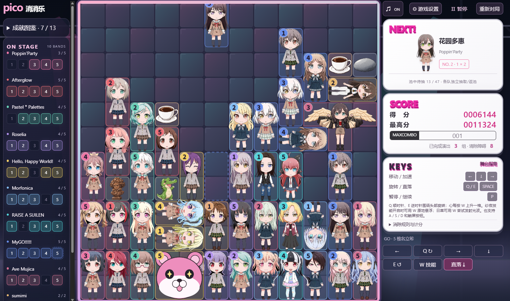

# PICO! ENCORE · 乐队连连落

**小小舞台，全员集合！**

一款以 BanG Dream! 角色为主题的同人下落消除小游戏。移动、旋转落下的角色，让同一乐队的成员相连，在接连不断的消除中挑战更高分。



## 这次，让谁登台？

- **组起你的乐队**：选择喜欢的乐队，让熟悉的角色在棋盘上相遇。
- **角色各显神通**：收藏、吃货、巨大化……角色技能和各式障碍物，让每一局都有新的意外。
- **追逐连锁与羁绊**：安排落点，触发连锁，发现角色之间的特别组合。
- **按你的节奏玩**：调整棋盘、速度与技能开关，支持键盘和手机触屏，下载后也能离线游玩。

## 开始游戏

下载本仓库并解压，用现代浏览器打开 **`index.html`** 即可，无需安装依赖。

也可以在安装 Node.js 后运行：

```sh
npm start
```

然后访问 [localhost:4173](http://localhost:4173)。

**基本操作**：← / → 移动，Q / E 旋转，↓ 加速，空格直落，P 暂停。手机可使用棋盘下方的触屏按钮；更多规则和技能介绍可在游戏内查看。

## 开发与素材

运行 `npm test` 执行自动测试。素材与音频说明见 [美术资源](docs/ASSETS.md) 和 [音频说明](docs/AUDIO.md)。

## License

本项目为非官方同人游戏。原创代码采用 [MIT License](LICENSE)；第三方角色、图像和音频素材的权利归各自权利人所有，不因本许可证而改变。
